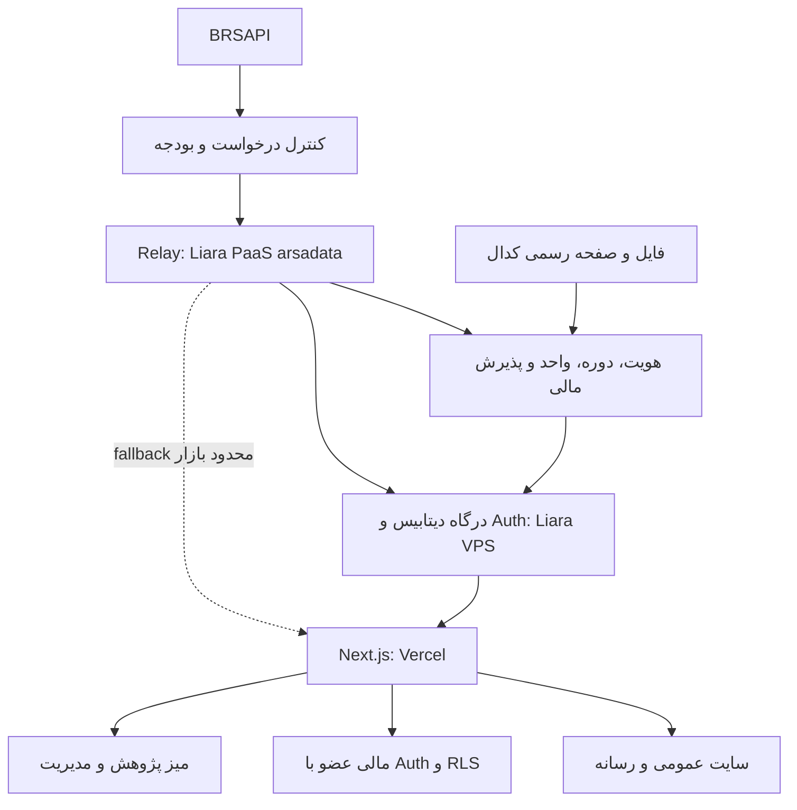

# معماری پلتفرم آرش صفری

بازبینی ساختار: 2026-11-14. هویت: **آرش صفری — تحلیلگر و مشاور سرمایه‌گذاری**.

این سند نقشهٔ سرویس‌ها و قراردادهاست، نه دفتر وضعیت دوم. نسخهٔ مستقر، آخرین چرخه و مانع در [COMMAND-CENTER](./COMMAND-CENTER.md)، جهت محصول در [PRODUCT-BLUEPRINT](./PRODUCT-BLUEPRINT.md)، تصمیم‌ها در [DECISION-LOG](./DECISION-LOG.md)، مسئولیت‌ها در [SERVICE-OWNERSHIP](./SERVICE-OWNERSHIP.md)، تنظیمات در [ENVIRONMENT-MATRIX](./ENVIRONMENT-MATRIX.md) و اجرای تغییر دیتابیس در [MIGRATION-LEDGER](./MIGRATION-LEDGER.md) ثبت می‌شوند.
بازسازی این سند به‌معنی مهاجرت زیرساخت یا اتمام محصول نیست. نسخهٔ قدیمی تیرماه در تاریخچهٔ Git محفوظ است.

## ۱. سه فضای محصول

| فضا | مصرف‌کننده | مسئولیت |
|---|---|---|
| خانه، رسانه، آموزش و نمای بازار | بازدیدکننده | معرفی آرش، محتوای واقعی، داده با منبع و زمان |
| فضای شخصی عضو | عضو دوره/مشاوره/خدمات | دارایی، بدهی، خالص ثروت، سبد و مدیریت مالی؛ اطلاعات خصوصی هر عضو |
| میز آرش و مدیریت | مدیر و تحلیلگر مجاز | پژوهش، بررسی مشاوره، محتوا، دسترسی و پایش عملیات |

مدیریت دارایی و ثروت شرح خدمات است؛ عنوان آرش را عوض نمی‌کند. سه طرح بصری از قراردادهای مشترک استفاده می‌کنند و دیتابیس یا محاسبات موازی نمی‌سازند. وجود صفحه، endpoint یا نمونهٔ نمایشی اثبات تکمیل مسیر عضو نیست.

## ۲. نقشهٔ اتصال واقعی

| جزء | مقصد/کد | مرز شواهد |
|---|---|---|
| سایت | https://portfolio-platform-fawn.vercel.app ؛ Next.js App Router | alias اصلی؛ انتشار frontend از Relay جداست |
| جمع‌آورنده | https://arsadata.liara.run ؛ `relay/server.mjs`؛ پورت 3400 | Liara PaaS؛ زمان‌بندی داخل فرایند |
| درگاه داده | `https://62.60.191.24/liara-preview` | اتصال مشاهده‌شدهٔ سایت و Relay؛ نام preview اثبات آزمایشی‌بودن نیست |
| DB/Auth | Postgres/PostgREST و پروتکل Supabase پشت درگاه | نسخهٔ دقیق کانتینرهای زیرین نیازمند بازخوانی مستقل است |
| انتشار | GitHub Actions و کنترل‌پنل میزبان | SHA، image و release فعال باید تطبیق داده شوند |
| سرویس‌های تاریخی | Supabase Cloud، Mini App/Manus، هدف Coolify | فعال یا خاموش‌بودن آن‌ها در این ممیزی اثبات نشده است |

PaaS و VPS دو نقش متفاوت دارند. دو حساب لیارا بدون ردگیری درخواست علت خرابی نیست. شناسهٔ Supabase Cloud در سند تیرماه مقصد جاری تأییدشده محسوب نمی‌شود؛ این بازبینی مجوز حذف آن سرویس یا داده‌هایش نیست.

## ۳. مسیر خانواده‌های داده

| خانواده | تولید و پذیرش | ذخیره | مصرف |
|---|---|---|---|
| سهم، صندوق، طلا، ارز، شاخص، اختیار | دریافت خانواده‌ای Relay؛ حفظ قبلی هنگام شکست | `ir_market_snapshots`، کلید `latest` | API بازار، بازار و نماد |
| NAV | صندوق معتبر پس از فیلتر زیرنماد؛ تاریخ و نوع واحد | payload بازار و وضعیت پایدار NAV | کارت صندوق و حباب |
| فهرست کدال | فید/آرشیو، cursor و حذف تکرار | `codal_feed` | کدال و کشف گزارش |
| ماهانه/صورت مالی | موتور کدال، فایل رسمی، parser و پذیرش | `codal_reports` با منبع/دوره/واحد/هویت | بنیادی و پژوهش |
| تاریخچه | history/EOD/کندل با قواعد مستقل | `ir_market_history`، `symbol_history`، `fx_rates`، `index_history`، `market_breadth` | نمودار و محاسبات |
| مالی عضو | APIهای `personal-finance` و `portfolio` | جدول‌های عضو طبق migration و RLS قابلیت | داشبورد خصوصی |
| رسانه/آموزش | محتوا، تلگرام و مدیریت | قراردادهای محتوای موجود | خانه، رسانه و آموزش |

`ir_market_snapshots` صرفاً append-only نیست: latest و کلیدهای وضعیت تغییر می‌کنند. `codal_reports` و `symbol_history` تاریخچهٔ append-only هستند. فهرست، دریافت فایل، پذیرش، ذخیره و نمایش مراحل متفاوت‌اند.

## ۴. قرارداد صحت

- زمان منبع/معامله، NAV، دریافت و محاسبه جدا هستند؛ receipt امروز اثبات قیمت امروز نیست.
- نبود مقدار، دوره، واحد یا دامنهٔ مستقل/تلفیقی با صفر یا حدس پر نمی‌شود.
- گزارش تجمعی با فصل مستقل یکی نیست؛ اصلاحیه و هویت ناشر کنترل می‌شوند.
- بیمه، بانک، سرمایه‌گذاری و صنعت الزاماً مدل مالی یکسان ندارند.
- شکست یک خانواده، ردیف و ساعت قبلی همان خانواده را نگه می‌دارد؛ فقط خالی معتبر اجازهٔ خالی‌کردن دارد.
- partial فقط با baseline معتبر ذخیره می‌شود؛ تعویق یک خانواده نباید جلوی دادهٔ تازهٔ دیگران را بگیرد.
- اجازهٔ ذخیرهٔ partial مجوز history/EOD از دادهٔ کهنه نیست.
- حباب به قیمت و NAV معتبر و قابل مقایسه نیاز دارد؛ بسته‌بودن بازار با خرابی دریافت فرق دارد.

کدهای محوری: `relay/market-retention.mjs`، `lib/market-quality.ts`، `lib/core/fundBubble.ts` و parserهای کدال. هدف، پوشش خودکار شرکت‌هاست؛ موفقیت یک نمونه اثبات پوشش همهٔ قالب‌ها نیست.

## ۵. کنترل درخواست و بودجه

منبع فعلی BRSAPI و فایل‌های رسمی مجاز است. MCP فارسی در مسیر فعال سایت فرض نمی‌شود؛ اتصال ابزار به Codex اتصال خودکار backend نیست.

طبق پیام ارائه‌شدهٔ مالک، سقف حساب ۱۵۰۰ درخواست در پنج دقیقه و حداقل فاصله ۵۰ میلی‌ثانیه است. تنظیم محافظه‌کارانهٔ مشاهده‌شدهٔ Relay: فاصلهٔ ۳۰۰ میلی‌ثانیه پس از پایان درخواست، سقف ۳۰۰ در پنج دقیقه و مهلت شروع ۳۰۰ ثانیه.

بودجهٔ داخلی روزانه با روز تهران: bulk تا ۶۰۰۰، standard تا ۷۵۰۰ و critical تا ۹۰۰۰. این اعداد سهمیه یا باقی‌ماندهٔ واقعی تأمین‌کننده نیستند. آرشیو سقف داخلی ۲۰۰ و روز UTC دارد؛ تفاوت مبنای روز باید در تحلیل مصرف لحاظ شود. مقدار نامعلوم مصرف، صفر یا مجوز مصرف نیست.

مسیر مشاهده‌شده کنترل legacy و lease ماندگار دارد؛ وجود client جدید اثبات فعال‌بودن flag آن نیست. بودجهٔ مشترک با فاصله‌گذاری سراسری متفاوت است: `globalEnforced=false` اجازهٔ ادعای تضمین فاصلهٔ تمام فرایندها را نمی‌دهد. یک replica و انتشار بدون هم‌پوشانی ریسک را کم می‌کند، ولی مصرف‌کنندهٔ بیرونی همان کلید را رد نمی‌کند. افزودن worker نباید این کنترل‌ها را دور بزند.

## ۶. زمان‌بندی و دوام اجرا

| کار | مالک اجرا | cadence کد/تنظیمات | شاهد لازم |
|---|---|---|---|
| بازار | timer در Relay | ۵ دقیقه | دو چرخهٔ طبیعی ذخیره و تطبیق سایت |
| NAV اصلی | Relay | ساعتی؛ حداکثر ۱۵۰ | NAV معتبر و چرخش پوشش |
| تکمیل NAV | Relay | هر ۱۲ ساعت؛ سقف ۴۰۰ | تابع بودجه و فیلتر، نه تضمین تکمیل |
| مشخصات صندوق | Relay | ساعتی، batch ۵۰، cache هفتگی | تفکیک خطای بودجه/منبع/ساختار |
| موتور کدال | Relay | روز ۳ ساعت؛ ۲۰ تا ۰۸ تهران ۱۵ دقیقه پس از اتمام | cursor، عدم هم‌زمانی موتور و پذیرش |
| آرشیو | Relay | شروع پس از ۶ دقیقه، سپس ۴۵ دقیقه | cursor پایدار و پیشرفت جزئی |
| کندل در صورت فعال‌بودن | Relay | شروع پس از ۳ دقیقه، سپس ۱۰ دقیقه | منبع و قرارداد سری |
| bridge | Relay | poll هر ۴۵ ثانیه، شروع پس از ۱۵ ثانیه | رسید اجرای واقعی |
| هشدار/تلگرام | Vercel Cron | `0 6 * * *` / `0 3 * * *` در `vercel.json` | موفقیت واقعی، نه وجود config |

برای IME و سایر jobها، flag و cadence مؤثر نسخه باید بازخوانی شود؛ مقدار حدسی ثبت نمی‌شود. timer با انجماد PaaS متوقف می‌شود. cache یا ترافیک سایت جای scheduler نیست. ماندگاری cursor و بودجه برای restart لازم است و تضمین uptime نیست.

## ۷. خواندن سایت و امنیت

`lib/market-ir.ts` ابتدا snapshot ذخیره‌شده را می‌خواند. `getIrMarket` fallback محدود Relay و سپس cache دارد؛ readerهای صریح stored-only ندارند. timeout و cache نباید دادهٔ کهنه را تازه معرفی کنند. `lib/market.ts` مسیر بازار جهانی جداگانه است، نه جایگزین ممیزی بازار ایران.

جفت `NEXT_PUBLIC_LIARA_API_URL` و `NEXT_PUBLIC_LIARA_ANON_KEY` در build به aliasهای عمومی Supabase متصل می‌شوند. وجود مقدار در پنل شاهد استفادهٔ build/runtime نیست؛ bundle، فرایند و درخواست واقعی باید تطبیق داده شوند. هیچ کلید یا اطلاعات عضو در سند و receipt عمومی قرار نمی‌گیرد.

نقش مدیر و RLS روی API/DB اعمال می‌شوند؛ مخفی‌کردن دکمه مجوز نیست. client مرورگر، server با کوکی و admin با service-role مرزهای جدا دارند. در Relay تنها `/healthz` از bearer مستثناست؛ `/debug` عمومی بدون رمز نیست. پاسخ ۲۰۰ سلامت داده را اثبات نمی‌کند.

## ۸. پژوهش و ایجنت‌ها

کد پژوهش از جمله `lib/intelligence/research-agent.ts` لایه‌ای جدا از جمع‌آوری است. هر ایجنت به ورودی، ابزار مجاز، بودجه، scheduler، خروجی ذخیره‌شده و معیار پذیرش نیاز دارد. وجود فایل، چت یا Hermes شاهد فعالیت شبانه‌روزی نیست؛ پذیرش عملیاتی همهٔ ایجنت‌ها در این ممیزی احراز نشده است.

جریان هدف: دادهٔ معتبر ← محاسبات قابل بازتولید ← تحلیل با منبع و فرض ← بررسی آرش ← ارائهٔ مجاز به عضو. متن خارجی دستور اجرایی نیست. خروجی مدل مستقیماً SQL، معامله یا ارسال به عضو را اجرا نمی‌کند. قواعد موجود `qualitativeMask` و حریم خصوصی حفظ می‌شوند.

## ۹. طبقه‌بندی خرابی

جهت محصول ۱۵ نوامبر: تحویل بنیادی این مسیر «گزارش فعالیت ماهانهٔ ن-۳۰ و روند آن در کارت و نمودار نماد» است. اجرای خودکار جدید برای پردازش صورت مالی ن-۱۰ برنامه‌ریزی نمی‌شود؛ سوابق موجود ن-۱۰ برای خواندن در دسترس می‌مانند و اطلاعیه‌های خام عمومی همچنان ثبت می‌شوند.

صف جبران ماهانه از اطلاعیه‌های ذخیره‌شده با نشانگر جدا استفاده می‌کند. ثبت معتبر اطلاعیه می‌تواند پیش برود حتی وقتی یک فایل برای پردازش رد می‌شود؛ این دو مرحله شاهدهای جدا دارند. صفحهٔ نماد گزارش‌های ماهانهٔ قابل‌استفاده را حتی هنگام خطای خواندن صورت‌های مالی تاریخی نمایش می‌دهد. وضعیت انتشار و پوشش واقعی در COMMAND-CENTER ثبت می‌شود.

| مرحله | نمونه | رفتار و شاهد |
|---|---|---|
| منبع | HTTP500، CAPTCHA | retry محدود؛ CAPTCHA دور زده نمی‌شود |
| محدودکننده | budget unavailable/exhausted | توقف مصرف مربوط، حفظ خانوادهٔ سالم، بدون reset مصنوعی |
| پردازش | unsupported layout، دوره/هویت نامعلوم | شاهد و علت؛ بدون صفرسازی یا پذیرش اجباری |
| ذخیره | timeout/RPC/schema/permission | مقصد واقعی؛ در نوشتن نامعلوم ابتدا readback |
| سایت | timeout/cache/قرارداد | تطبیق رکورد، API و صفحه با نسخه و زمان |
| scheduler | انجماد/restart | آخرین تلاش جدا از آخرین موفقیت؛ بررسی cursor |

نقص تأییدشدهٔ ۱۴ نوامبر: توقف خانوادهٔ standard می‌توانست ذخیرهٔ خانواده‌های critical دریافت‌شده را متوقف کند. اصلاح، ذخیرهٔ partial با baseline معتبر است. در ۱۵ نوامبر هم مشخص شد توقف دانلود فایل‌های کدال، کشف اطلاعیه از BRSAPI را در نسخهٔ مستقر متوقف می‌کند؛ این دو مقصد جدا دارند.

سیاست کاندیدای ۱۵ نوامبر: قیمت سهم و صندوق از همان فید مشترک باقی می‌ماند؛ NAV ده صندوق بر اساس ارزش معاملات ساعتی و حداکثر ۹۰ صندوق با NAV غایب/کهنه هر شش ساعت با اولویت قدیمی‌ترین زمان دریافت. هر دو از کلاس bulk استفاده می‌کنند تا کشف اطلاعیهٔ جدید در standard بودجه داشته باشد. کشف سراسری حداکثر هر ۱۵ دقیقه پس از پایان چرخهٔ قبل نوبت می‌گیرد؛ نوبت کار تاریخی در روز سه‌ساعته می‌ماند. در زمان محدودیت فایل رسمی، فید BRSAPI جدا ادامه دارد و نشانهٔ پیشرفت اطلاعیه با نشانهٔ پردازش مالی یکی نیست. هیچ‌کدام از این موارد بدون رسید انتشار و چرخهٔ طبیعی، تغییر تأییدشدهٔ سایت نیست؛ وضعیت نشر در COMMAND-CENTER است.

## ۱۰. انتشار و بازگشت

1. تغییر محدود در شاخهٔ codex، بررسی diff و آزمون قرارداد مرتبط.
2. ثبت SHA و CI؛ merge برابر استقرار نیست.
3. انتشار جزء روی مقصد خودش: frontend در Vercel، Relay در Liara، migration مستقل DB.
4. بازخوانی image/release و اتصال مؤثر؛ حفظ نسخهٔ قبلی برای rollback.
5. دو چرخهٔ طبیعی متناسب با منبع و تطبیق منبع/ذخیره/API/صفحه.
6. ثبت نتیجه و محدودیت در COMMAND-CENTER؛ چرخهٔ دوره‌ای سالم الزاماً گزارش تازه ندارد.

تغییر schema نیازمند بررسی migration موجود، پشتیبان و سازگاری طبق اختیار معتبر است. تعمیر مجوز حذف داده، reset مصرف، خرید یا ساخت DB موازی نیست.

## ۱۱. کارهای باقی‌ماندهٔ ساختاری و معیار پایان

| محور | تحویل لازم برای کامل‌شدن |
|---|---|
| داده | چرخهٔ پایدار، پوشش شرکت/قالب قابل شمارش و وضعیت خانواده‌ها در سایت |
| مالی عضو | آزمون عضو عادی: دارایی، بدهی، خالص ثروت، سبد، حریم خصوصی و بازیابی خطا |
| پژوهش | خروجی واقعی با منابع قابل بازشدن، کیفیت بررسی‌شده و scheduler اثبات‌شده |
| طراحی/رسانه | هویت آرش، انتخاب طرح سراسری و محتوای واقعی روی موبایل و دسکتاپ |
| عملیات | محدودکنندهٔ مشترک قابل اثبات، پایش شکست، backup/restore و rollback آزموده‌شده |

هر تغییر اتصال یا scheduler باید همین سند را اصلاح کند. وضعیت اجرایی فقط در COMMAND-CENTER می‌ماند. بازسازی ساختار با بازخوانی کل پروژه در هر نوبت جایگزین نمی‌شود: ابتدا همین نقشه، سپس شاهد و کد همان بخش.
