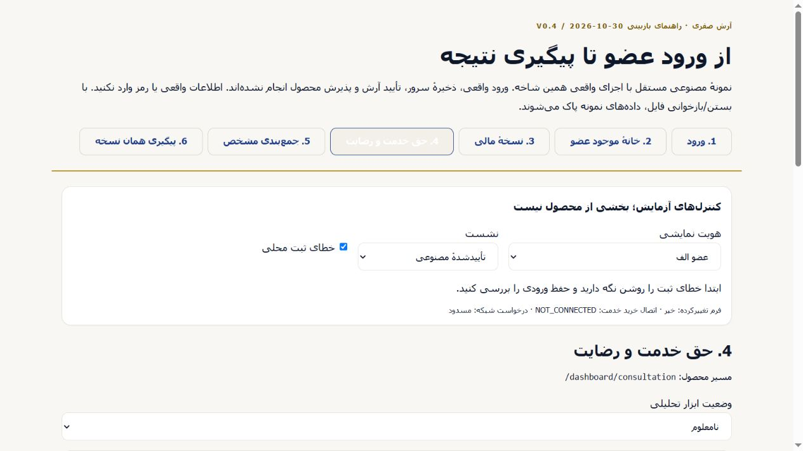
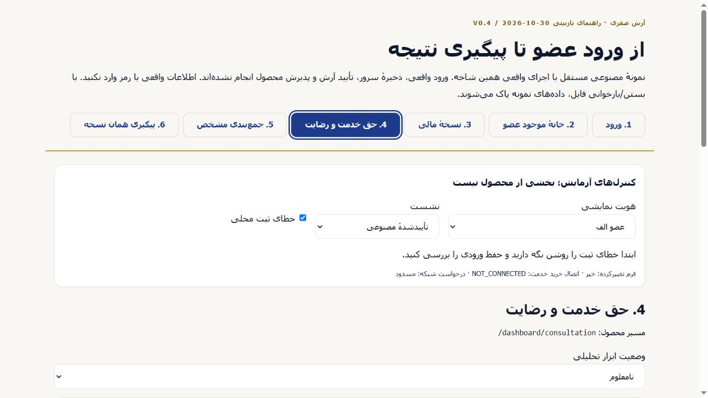

# P2 review-frame active-step contrast correction

Root reproduced a real defect on step 4 in the fixed df41 Preview: selected-step text became almost white on a light surface while the pointer remained over the button. Its screenshot is preserved as contrast-before-root.png. The original commit, HTML hash `ed4f9a3621af25c0cd19b2bc0e073964addfab6e05de0fd9d4c67f2a29793210`, and exact Preview remain in MANIFEST.json.previousArtifact; history is not replaced.

Cause: the global `.btn-outline:hover:not(:disabled)` selector has specificity (0,3,0), higher than the frame's `.review-head [aria-current]` (0,2,0). Hover changed the background to `--surface-2` while the selected white text remained. Browser readback confirmed foreground rgb(255,255,255) on rgb(242,240,232), contrast 1.141:1.

Only the standalone review-frame rule and its builder were changed. The frame now scopes the selected button through `.review-head nav .btn[aria-current="step"]` (0,3,1), explicitly including its hover state. It uses the existing `--navy` and `--text-on-navy` tokens and keeps the border consistent. A scoped `:focus-visible` rule uses `--focus` with a declared 3px outline and 3px offset. No product/global CSS, component, Auth, API or model change is involved; the compiled script, fixture data and CSP remain byte-identical.

Local browser verification covered selected normal, selected with pointer hover, and selected with pointer hover plus keyboard focus. Shift+Tab then Tab returned focus to step 4; :focus-visible was true with a visible solid outline and offset. All three states retained rgb(248,250,252) on rgb(30,58,138), contrast 9.900:1. See contrast-check.json and contrast-after-keyboard.png. Values are computed browser colors, with contrast calculated from sRGB relative luminance; this is bounded evidence for these states.

The frozen product remains PR341/c0eadab. No product test rerun is needed for this CSS-only static artifact; exact new Preview identity/hash and a fresh visual check are recorded separately after deployment. This correction does not establish real Auth, server persistence, service entitlement or Arash acceptance. PR342 remains DRAFT / NOT_FOR_MERGE.

