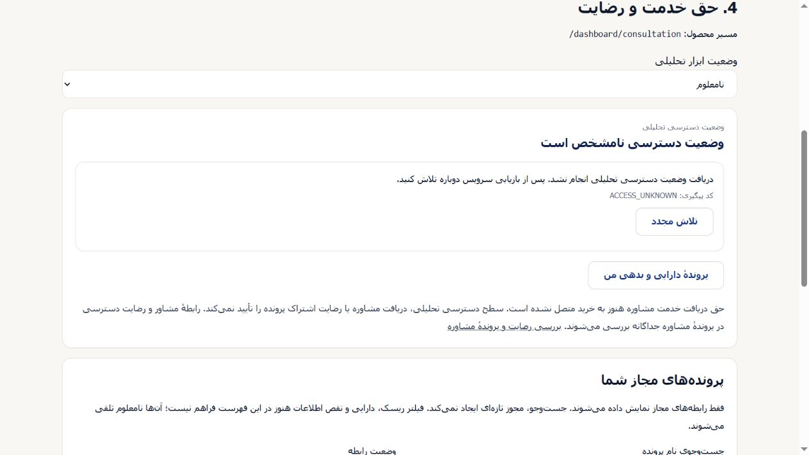

# NOT_FOR_MERGE — independent member walkthrough

Preview artifact only. The integration coordinator authorized publishing the **unchanged** local HTML on an independent branch using the existing Vercel project. This branch must not merge into product/main. Product PR341 remains frozen at `c0eadaba4be1a070d3f93b2c9706e2c13e9a20f3`.

Open the deployment's `/design/member-journey-v04/index.html`. It is the fixed self-contained HTML reviewed locally, SHA256 `ed4f9a3621af25c0cd19b2bc0e073964addfab6e05de0fd9d4c67f2a29793210`. It adds a static public file only, with no application route, fake API or environment switch. No production promotion is authorized.

The real LoginPage, DashboardClient, CashFlowEditor, AccessStatusCard, ReadError, ConsultationPanel and SessionCard are traceable to the frozen product commit in MANIFEST.json. All other bundled local source dependencies also have workspace and Git-blob hashes. The harness source and builder are preserved as `.txt` review files so they do not enter the product build/typecheck. The public HTML is unchanged; deployment readback must verify that hash again.

Every person, account, approval, version and feedback is synthetic. Auth, payment, signout, storage and network are blocked; fixture commands only change in-memory data. No real login, real consent grant, Arash approval or server persistence is demonstrated. Closing/reloading resets the fixture. NOT_CONNECTED purchase-to-service linkage remains explicit. Neither ordinary admin nor member B is granted A's relationship.

The six-step review and checks are described in the parent DELIVERY.md. The desktop/mobile screenshots here are synthetic UI evidence only. Product CI/Preview, authenticated destination behavior, financial provenance, primary durability and Arash acceptance remain separate gates. Preserve the existing source/version/error semantics and do not treat this static demo as product acceptance.

To rebuild for inspection, copy `walkthrough.tsx.txt` and `build-walkthrough.cjs.txt` to a disposable directory without the `.txt` suffix. From the frozen product checkout, run its existing Node against that builder path; it resolves dependencies and sources from the working checkout and writes the independent HTML beside the harness. No install, key setup or remote request is needed. A rebuild is a new artifact until its hash is reconciled; the published file here remains the fixed reviewed artifact.

