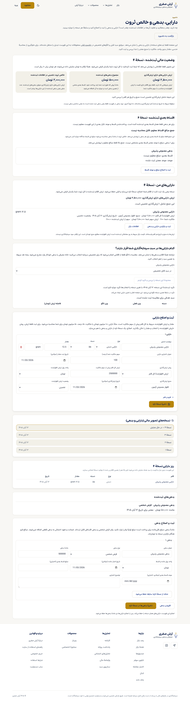
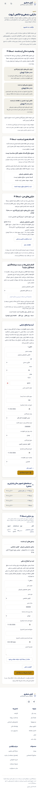

# پذیرش محدود دفتر مالی روی مقصد واقعی — ۳ نوامبر ۲۰۲۶

نسخهٔ منتشرشده `56c9818ccb9a546391c500efb9199f01b9ea4091`؛ [دارایی، بدهی و خالص ثروت](https://portfolio-platform-fawn.vercel.app/dashboard/holdings). این صفحه برای حساب واردشده است. آزمون روی یک حساب عادی مستقل تیم، با مبلغ و عنوان صریحاً مصنوعی انجام شد؛ هیچ حساب مشتری یا حق خرید/مشاوره تغییر نکرد.

## چه چیزی واقعاً آزموده شد؟

ورود بومی حساب → ثبت دارایی و بدهی و محدوده از APIهای موجود → خواندن مستقل همان نسخه‌ها → بازکردن صفحه در Chrome مستقل → خروج واقعی از دکمهٔ داشبورد و هدایت مهمان به ورود → ورود مجدد → تغییر دارایی و بدهی از خود فرم‌های واقعی → تأیید محدودهٔ همان نسخهٔ تازه از فرم → ورود تازه و خواندن دوبارهٔ نسخهٔ۴، تاریخچه و سبد.

سه POST مرحله API و سه POST مستقل مرحله فرم، هرکدام یک‌بار ارسال شدند؛ intent قبل از ارسال در مسیر خصوصی محفوظ است. مرحله فرم نخست بعد از دو رسید موفق timeout داشت؛ دو ثبت تکرار نشدند، نسخهٔ۴ بازخوانی و فقط تأیید سبدِ هنوز ارسال‌نشده یک‌بار ثبت شد. رسید شکست قبلی محفوظ است.

نسخه‌های۱ تا۴، چهار ردیف دارایی تاریخی، سه ردیف بدهی تاریخی و دو تأیید محدودهٔ متصل به نسخه‌های۲ و۴ مستقلاً تطبیق شدند. نسخهٔ۴: دارایی۲٬۵۰۰٬۰۰۰، بدهی۵۰۰٬۰۰۰، خالص۲٬۰۰۰٬۰۰۰ تومان با برچسب تخمینی؛ مقدار۱۲٫۵ و قسط نامعلوم/null حفظ شدند. نسخه‌های قدیمی بازنویسی نشدند.

خواندن نهایی پس از ورود تازه و نمایش تأیید سبد موفق بود. در Chrome156 مستقل، دسکتاپ1280 و موبایل390 بررسی شدند؛ عرض سند موبایل390 و خطای اجرایی ثبت‌شده صفر بود. این نتیجه تأیید بصری انسانی آرش نیست.

حساب آزمون در پایان بازنشسته شد: ban موفق، logout سراسری204، نشست/refresh token/refresh فعال همگی صفر و hash تاریخچه ثابت. رمز، token، شناسه حساب و فایل‌های خصوصی در این تحویل منتشر نشده‌اند. تصویرها فقط دادهٔ مصنوعی همان حساب را نشان می‌دهند.

## حدود باقی‌مانده

- Preview387 با همان نشست پاسخ401 داد؛ پذیرش واقعی با نسخهٔ دقیق Production56c انجام شد. تنظیم Auth برای دورزدن این تفاوت تغییر نکرد.
- نخستین خروج مرورگری و هدایت مهمان موفق بود؛ تلاش آخرِ driver خروج به timeout خورد و موفق فرض نشد. ورود تازهٔ بعدی و بازنشستگی نهایی جدا تأیید شدند.
- این پذیرش فقط دفتر پایهٔ آزموده‌شده است. مسیر کامل درخواست مشاوره/پاسخ مدیر/حق خدمت، جریان نقد، بودجه، اهداف و کل بسته‌های P01/P03/P14 همچنان معیارهای مستقل باز دارند.
- بستهٔ نمودار مقدار در PR388 است؛ Core/build و DB موفق، ولی اسکن fixture آن نیازمند اصلاح محدود است. هنوز دادهٔ زندهٔ مقدار یا انتشار آن پذیرفته نشده است.

[رسید پاک‌شده](receipt.json) · [هش تصاویر](manifest.json). مرجع وضعیت همچنان COMMAND-CENTER است.

## تصویر واقعی دسکتاپ

## تصویر واقعی موبایل

