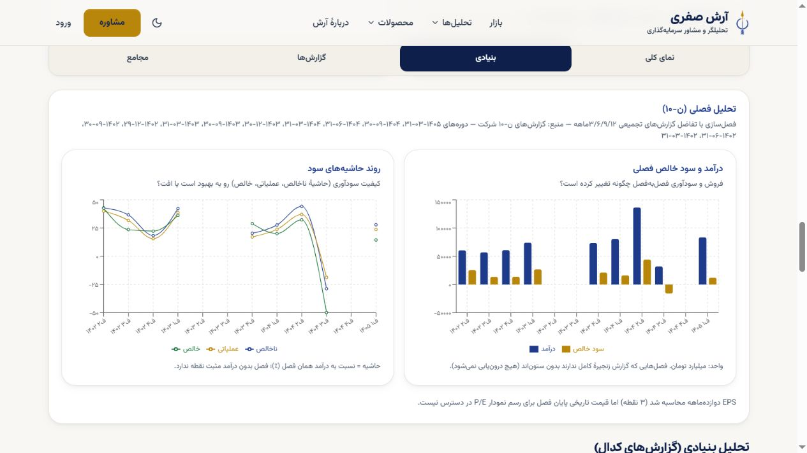

# صفحهٔ واقعی فولاد — پذیرش محدود خواندن و رندر، ۳۱ اکتبر ۲۰۲۶

[بازکردن پیش‌نمایش تعاملی](https://portfolio-platform-c19w20kgz-safariarash7777-4463s-projects.vercel.app/symbol/%D9%81%D9%88%D9%84%D8%A7%D8%AF#fundamental) · [کد Draft374](https://github.com/safariarash7777-source/portfolio-platform/pull/374) · [مرجع جاری](../../../../COMMAND-CENTER.md#development-v04-program-20261030)

**چه چیزی واقعاً نمایش داده شد:** در نسخهٔ دقیق805a8d9، گزارش‌های موجود ن۱۰/ن۳۰ از مقصد ثابت لیارا خوانده شدند و نمودارهای فروش ماهانه، درآمد/سود خالص فصلی، حاشیه‌های سود و مقایسهٔ سالانه روی صفحهٔ واقعی شرکت رندر شدند. دو کنترل بازشدن روند و جدول محصولات، و جابه‌جایی بنیادی↔گزارش‌ها کار کردند. این دادهٔ آموزشی یا آزمایشگاه واردشده به محصول نیست. این تحویل، برش خواندن/رندر در Preview است؛ پذیرش کل P07، صحت جامع همهٔ محاسبات مالی، انتخاب ظاهر آرش یا انتشار اصلی نیست.

## مسیر استفاده و نسخه

صفحهٔ فولاد را باز کنید، «بنیادی» را انتخاب کنید و به «تحلیل فصلی» برسید؛ روند/جدول ماهانه در ابتدای همین تب بازشدنی‌اند. تب «گزارش‌ها» دو لینک اصلیِ همین گزارش‌های مصرف‌شده را دارد. دکمهٔ «دریافت فهرست» یک مسیر خواندنی مستقل است که هنوز خطا دارد.

source=`805a8d905c9d82697745988b21ff4f1222f8969d`؛ tree=`c5f20ab832ab985dd32190ee53d306a849ddbec0`؛ deployment=`dpl_8JqHf76mhDZiw5SMLqpDtMvpkjfR`؛ target=null یعنی Preview. [CI مستقل root](../P07-374-805-root-ci-20261031.json) هر۵job، checkout واقعی97d343 و برابری کلtree و حضور واقعی۱۶binding/۶wiring/۴validator در لاگ رسمی را تأیید کرد. شکست registry نسخهfa و اصلاح محدود ثبت آزمون محفوظ‌اند؛ فقط CI آخر به805 تعلق دارد.

## منبع، دوره، واحد و محل توقف

| مسیر | آنچه در مرورگر دیده شد | حد نتیجه و باقی‌مانده |
|---|---|---|
| گزارش ماهانه از `codal_reports` |۱۰گزارش؛ آخرین دوره۱۴۰۵-۰۶-۳۱؛ [اطلاعیهٔ همین N30](https://codal.ir/Reports/Decision.aspx?LetterSerial=UF9BctCE5jV6HYNuyA8yYA%3d%3d&rt=0&let=58&ct=0&ft=-1)، مبلغ میلیون‌ریال با نمایش میلیاردتومان/همت؛ فروش شهریور۶۳۹۴۱٫۸میلیاردتومان | source11653/pv2 طبق شاهد قبلی؛ capture قبلی۲۵اکتبر و انتشار خام منبع۲۹مهر، زمان موفق خواندن امروز نیستند. آخرین چرخهٔ کامل موفق مالی همچنان UNKNOWN؛ صفحه هنوز ID/capture/نسخهٔ parser را کامل نشان نمی‌دهد |
| گزارش مالی ن۱۰ |دوره۱۴۰۵-۰۳-۳۱؛ انتشار خام نمایشی۱۴۰۵/۰۵/۰۳۱۶:۵۴:۵۳، واحد میلیون‌ریال؛ [اطلاعیهٔ مصرف‌شده](https://codal.ir/Reports/Decision.aspx?LetterSerial=yC2oQqrZ3w8Q8FsnnWQQBw%3d%3d&rt=0&let=6&ct=0&ft=-1)؛ سه گزارش تلفیقی مبهم از محاسبه کنار گذاشته شدند |نمودار دیده شد، ولی این شاهد ممیزی مستقل همهٔ رقم‌ها، ساعت UTC انتشار، فصل‌های ناقص یا تناسب روش نیست. علامت اعتبارسنجی حسابی، تأیید کل زنجیره نیست |
| مقدار/نرخ |برای pv2 واحد قابل‌مقایسه نامعلوم؛ مقدار/نرخ و شکاف تولید−فروش «—»/پیام کمبود ماندند |درست صفر یا نمودار ساختگی تولید نشد؛ نمایش واقعی این دو نمودار هنوز باز است. استخراج واحد در parser329 موجود است، اما اینجا روی رکورد قدیمی reparse/append نشده |
| تفکیک داخلی/صادرات/خدمات |صفحه هنوز صادرات۰٪ و «کل داخلی» می‌گوید و جدول همه را داخلی می‌نامد |**نقص باز و ادعای ناپذیرفته:** basis قدیمی تأییدشده نیست و [شاهد همان سند](../P06-N30-11653-unit-audit-C-root-read-20261031.json) داخلی/صادرات/خدمات دارد. A اصلاح سه زنجیرهٔ مدل/جدول/نمودار را با null برای تفکیک نامعلوم گرفته؛ این ادعا مبنای استفاده مالی قرار نمی‌گیرد |
| تابلوی بازار و تاریخچه |قیمت/زمان نامعلوم، «—» و خطای خواندن؛ `/api/symbol-detail` در لاگ همین Preview headers402 ثبت کرد |این اتصال مستقل از خواندن بنیادی است؛ علت billing/مجوز یا نبود داده اثبات نشده. قیمت، P/E تاریخی و تاریخچه بسته نشده‌اند |
| فهرست اطلاعیه‌های ذخیره‌شده |تب گزارش‌ها دو لینک مصرف‌شده را نشان داد؛ فقط یک کلیک «دریافت فهرست» خطا داد |لاگ `2026-10-31T04:16:38.830Z`، request=`6m4fr-1793420198703-dbc0467de27f`، `/api/codal-list`، headers402/۳۲ms. کد فعلی فقط `codal_feed` را با جفت legacy می‌خواند؛ نه provider job. C اتصال همان route با reuse resolver موجود را بررسی می‌کند |

## حدود عملیات و بازگشت

root از جفت anon **ازقبل موجود در همین پروژهٔ Vercel** برای دو تنظیم سروری Sensitive و فقط شاخهٔ `codex/p07-fundamental-read-binding-20261031`/Preview استفاده کرد. جفت عمومی Auth/SDK، نویسنده‌ها، main، سرویس اصلی، SQL/دادهٔ ذخیره‌شده، ingest/مدل یا Hermes تغییر نکردند؛ کلید جدید امضا/هویت ساخته یا rotate نشد و مقدار کلید در رسیدها نیست. ایجاد یک Preview دستی با GitSource دقیق805 انجام شد؛ guard خودکار شاخه false ماند. طبق [مرجع رسمی ساخت deployment](https://vercel.com/docs/rest-api/deployments/create-a-new-deployment)، نبود target پیش‌فرض Preview است؛ target=null و SHA/branch واقعی بعد از ساخت هم بازخوانی شدند.

**تمرین بازگشت محدودهٔ تنظیمات و بازگردانی، PASS محدود:** پس از دو رد ثبت‌شدهٔ اولیه، root دو ID/نام/Sensitive/Preview را به شاخهٔ موجود و فریز371 برد؛ source همانcdc این نام‌ها را در app/lib/components مصرف نمی‌کند. API نبود هر دو نام در805 و حضور همان دوID در371 را تأیید کرد؛ سپس هر دو به805 برگشتند و نبود باقی‌مانده در371/حضور دقیق805 بازخوانی شد. فقط gitBranch/comment تغییر کرد؛ type/value/key، کد، شاخهٔ Git یا deployment تازه‌ای تغییر/ساخته نشد. [رسید مراحل و محدودیت](../P15-Preview805-root-scope-20261031.json) این تمرین را فقط بازگشت تنظیمات می‌نامد، نه آزمون runtime با scope غیرفعال یا rollback نوشتن/پایگاه اصلی. UI حذف دائمی نشان داد و حذف انجام نشد؛ تلاش renameSensitive و scope فاقد Git branch قبلی با400 رد شدند و سابقه‌شان محفوظ است. Preview فعلی و همان جفت805 برای بررسی محفوظ‌اند؛ لغو اعتبارنامه، حذف دائمی یا انتشار اصلی انجام نشده است.

label لاگ runtime برای371 قبلی و805 هر دو `nodejs26.x` بود؛ metadata پروژه `24.x` نشان می‌دهد. این دو شاهد یکی فرض نشده‌اند و root تنظیم runtime را تغییر نداد. هیچ هزینه/پلن تازه خریداری نشد؛ مبلغ مصرف quota اجرای CI/Preview اینجا اندازه‌گیری نشده است.

## اقدام بعدی و مالک

A: حذف ادعای نادرست بازار از سه مدل/consumer با قرارداد `market_basis` موجود و حفظ مبلغ/اسلات/واحد معتبر؛ child محلی جدا از805، بدون انتقال کل329 یا metadataC42. C: reuse همان resolver سروری در مسیر موجود فهرست، سپس پیوند metadata منبع؛ آخرین چرخهٔ کامل موفق و انتشار دقیق هنوز مستقل بازند. root: یکپارچه‌سازی و QA Preview بعدی/بستن گیت عملیاتی تنظیمات؛ نصب و حق خدمت عضو گیت جدا هستند. انتخاب بصری/پذیرش آرش و کل برنامهٔ۰٫۴ همچنان بازند.

[جدول و کمبود مقدار در صفحهٔ واقعی](monthly-real.jpg) · [خطای مسیر مستقل فهرست](reports-real.jpg) · [مشاهدات نسخه‌دار](observations.json) · [manifest بایت‌ها](manifest.json)
