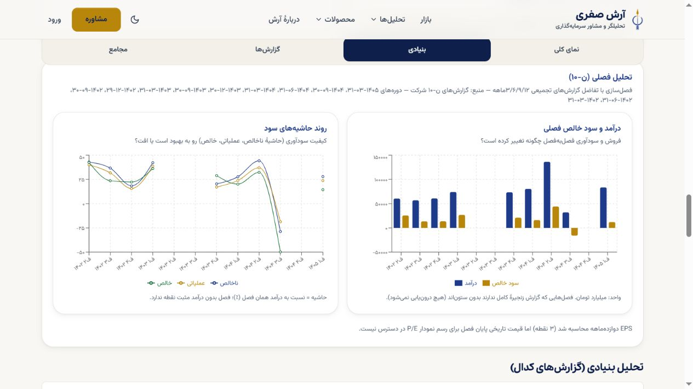
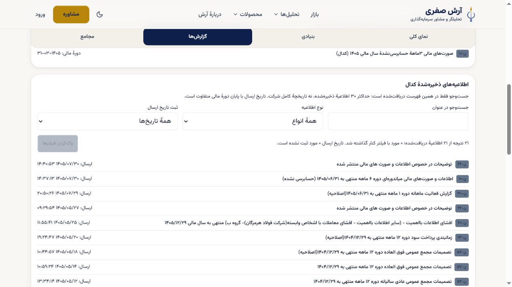

# فولاد c314 — رندر واقعی، اصلاح بازار و دریافت واقعی اطلاعیه‌ها

[بازکردن بنیادی](https://portfolio-platform-9bn08eb2l-safariarash7777-4463s-projects.vercel.app/symbol/%D9%81%D9%88%D9%84%D8%A7%D8%AF#fundamental) · [بازکردن گزارش‌ها](https://portfolio-platform-9bn08eb2l-safariarash7777-4463s-projects.vercel.app/symbol/%D9%81%D9%88%D9%84%D8%A7%D8%AF#reports) · [PR376](https://github.com/safariarash7777-source/portfolio-platform/pull/376) · [مرجع جاری](../../../../COMMAND-CENTER.md#development-v04-program-20261030)

**چه چیزی واقعاً قابل استفاده شد:** نمودار فروش، درآمد/سود خالص و حاشیه‌های ن۱۰/ن۳۰ با دادهٔ واقعی ذخیره‌شده نمایش داده می‌شوند. در کارت، جدول و نمودار، تفکیک بازار قدیمی «نامعلوم» است و ادعای نادرست صادرات صفر/کل‌داخلی حذف شده. با یک کلیک «دریافت فهرست»، ۲۱ اطلاعیهٔ واقعی با لینک کدال آمد؛ جست‌وجوی «اصلاحیه» ۲۱→۸ و پاک‌کردن ۸→۲۱ شد. این دادهٔ آزمایشگاه واردشده به محصول نیست.

## استفاده و نسخه

در بنیادی، «روند و ترکیب فروش» و «جدول محصولات» بازشدنی‌اند؛ در گزارش‌ها فهرست ذخیره‌شده را دریافت کنید. چهار تب و End/Home/جهت راست‌به‌چپ صفحه‌کلید در مرورگر root کار کردند. فهرست پس از جابه‌جایی تب‌ها باقی ماند و نیاز به دریافت دوم نبود. عرض۳۹۰ در نماهای بنیادی/گزارش‌ها اسکرول افقی سراسری نداشت؛ این پذیرش کامل ظاهر/دسترس‌پذیری یا آزمون دستگاه واقعی نیست.

source=`c314c6f0b6fbc64c45047c65d376250fe3dcf89f`، tree=`94552f0738571a702942d7a9ef44d1f9f42ba843`، deployment=`dpl_Dk2kUqnpQTVRDi91KhLRHEgsfDYA`، target=null یعنی Preview. [CI با بررسی مستقل root](../P07-376-c314-root-ci-20261031.json) پنج job، checkout واقعی2fa15d2/tree برابر، ده آزمون route با نام و اصلاح درصد مثبت کوچک در روایت/سه مصرف‌کننده را تأیید کرد. درصد بسیار کوچک در این دادهٔ واقعی ساخته نشد؛ آن مورد فقط شاهد CI دارد. [بستهٔ کد c1bb](../P07-c1bb-root-stack-review-20261031.json) و child صرفاً مستندات جدا هستند.

## داده، زمان و محل توقف

| مسیر | نتیجهٔ مشاهده‌شده | محدودیت باز |
|---|---|---|
| ن۳۰ / codal_reports |۱۰گزارش با واحد مبلغ مشخص؛ آخرین دوره۱۴۰۵-۰۶-۳۱، فروش نمایشی۶۳۹۴۱٫۸میلیاردتومان؛ منبع مبلغ میلیون‌ریال |واحد مقدار/نرخ رکوردهای قدیمی تأیید نشده؛ هر دو گپ/— ماندند. ID/capture/parser هر دوره در این نسخه هنوز به صفحه نمی‌رسند |
| ن۱۰ / نمودارهای مالی |سود و حاشیه با گپ واقعی رندر شدند؛ گزارش اصلی منتخب دوره۱۴۰۵-۰۳-۳۱ است، انتشار خام نمایشی۱۴۰۵/۰۵/۰۳۱۶:۵۴:۵۳ |رندر، ممیزی جامع رقم‌ها یا پایان کل P07 نیست؛ سه گزارش با دامنهٔ تلفیقی مبهم کنار گذاشته‌اند. [تصویر واقعی](quarterly-real.jpg) |
| تفکیک بازار |سهم صادرات در کارت—، جدول/ترکیب «تفکیک نامعلوم» و توضیح علت دارند؛ متن قدیمی کل‌داخلی دیده نشد |بازار واقعیِ هر ردیف با این اصلاح کشف/بازنویسی نشده؛ «نامعلوم» اعتماد تازه به داده ایجاد نمی‌کند. [تصویر](market-unknown.jpg) |
| codal_feed |یک دریافت صریح، ۲۱ اطلاعیه؛ پنجرهٔ نمایشی حداکثر۳۰، نه تمام تاریخچه. آخرین ارسالِ همین پنجره۱۴۰۵/۰۷/۳۰۱۴:۴۰:۵۳ |زمان ارسال نه دوره مالی، نه UTC انتشار، نه زمان capture یا آخرین چرخهٔ کامل است؛ موفقیت HTTP به‌صورت مستقل instrument نشده، شاهد موفقیت همان پاسخ معتبرِ رندرشده است |
| شکاف تازهٔ ن۱۰ |در فهرست، [اعلان شش‌ماهه منتهی به۱۴۰۵-۰۶-۳۱](https://codal.ir/Reports/Decision.aspx?LetterSerial=qV4MKXMUUbQQQaQQQ9cOOObOOO8qmo3wRg%3d%3d&rt=0&let=6&ct=0&ft=-1) با ارسال۱۴۰۵/۰۷/۳۰۱۴:۳۷:۱۳ وجود دارد؛ گزارش اصلی مصرف‌شده هنوز سه‌ماهه است |علت تفاوت **UNATTRIBUTED**؛ وجود اطلاعیه، پردازش معتبر دامنهٔ شرکت را ثابت نمی‌کند و بی‌شاهد به۱۸رد قبلی نسبت داده نشده است |
| قیمت/تاریخچه/مجامع |قیمت و تاریخچه خطای مستقل و مجامع پیام نبود داده دارند |[لاگ همین Preview](runtime-symbol-detail.txt) در05:45:27Z، request rnllf-1793425527489-a9cf27636112، headers402/۳۸ms را ثبت کرد؛ علت billing/مجوز نتیجه نشده است |

آخرین چرخهٔ کامل موفق مالی **UNKNOWN** است. دریافت امروز در مرورگر، تاریخ مالی/انتشار یا تازگی همهٔ داده‌ها را تغییر نمی‌دهد. [metadataac416](../P06-ac416-root-metadata-review-20261031.json) فقط نامزد مستقلِ بررسی‌شده است و هنوز در این deployment/UI نیست؛ C همان مسیر موجود را به اطلاعات هر گزارش وصل می‌کند.

## حدود عملیات و اقدام بعدی

root همان دو ID تنظیم Sensitive/Preview موجود را بدون تغییر key/value/type/target به شاخهٔ376 برد؛ نبود آن دو در805 و حضور دقیق در376 با API بازخوانی شد. فقط یک Preview با GitSource دقیق ساخته شد؛ [رسید محدوده و بازگشت](../P15-Preview-c314-root-scope-20261031.json). global Auth/write، SQL/ذخیره، main/Production و Hermes تغییر نکردند. این پذیرش Preview و پیکربندی، پشتیبان قابل بازیابی یا rollback مالی نیست؛ مبلغ quota اندازه‌گیری نشده و خرید/ارتقای پلن انجام نشده است.

تعهدهای باز و مسئول: A تطبیق metadata واحد مقدار/نرخ C42 با حفظ مقادیر/اسلات‌های canonical؛ C منشأ هر گزارش/زمان/واحد در همین صفحه و سپس انتساب شکاف پردازش؛ B خواندن و نمایش حق قدیمیِ خود عضو جدا از حق خدمتِ نامتصل؛ root Capture/Verify پشتیبان، ظرفیت تازه، نصب/ترتیب انتشار و پذیرش مقصد. حق همین خدمت **NOT_CONNECTED** و نصب اصلی **NOT_APPLIED** است؛ انتخاب ظاهر آرش و کل بسته‌های برنامه پذیرفته‌شده اعلام نمی‌شوند.

[موبایل](reports-mobile.jpg) · [مشاهدات و حدود](observations.json) · [تعامل‌ها](interaction-evidence.json) · [بایت‌های دقیق](manifest.json)
