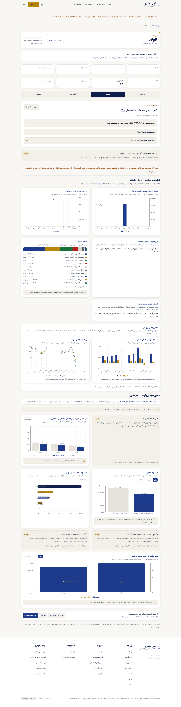
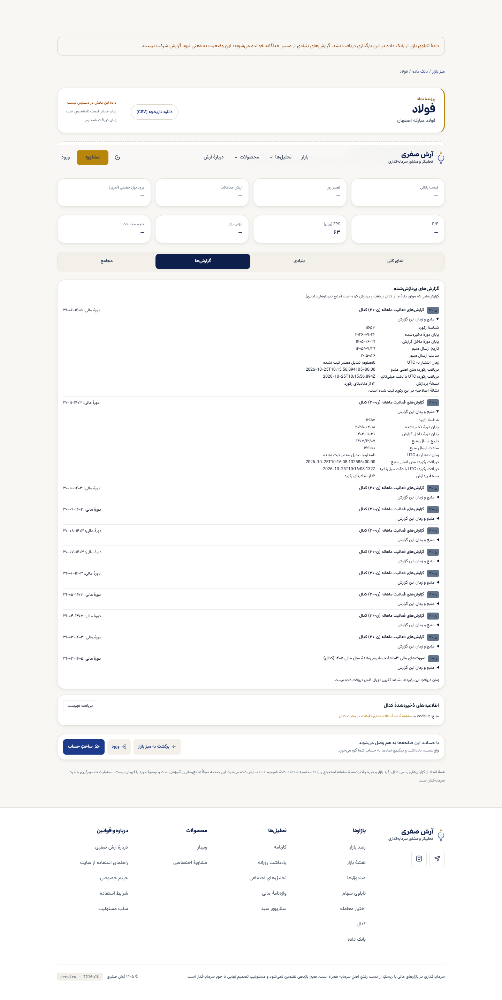
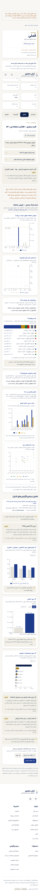

# پذیرش محدود پیش‌نمایش واقعی شرکت و صندوق — ۴ نوامبر تهران

نسخه `7216a1bac6cb393ff87ad9798e439de361092303`، deployment `dpl_Dmsdvy3JMpxzfYZRekeyPPhrv78s`، هدف Preview است؛ این رسید، انتشار Production نیست.

- [فولاد، تب بنیادی](https://portfolio-platform-ph6aqz9zk-safariarash7777-4463s-projects.vercel.app/symbol/فولاد#fundamental)
- [فملی، تب بنیادی](https://portfolio-platform-ph6aqz9zk-safariarash7777-4463s-projects.vercel.app/symbol/فملی#fundamental)
- [منبع و زمان گزارش‌های فولاد](https://portfolio-platform-ph6aqz9zk-safariarash7777-4463s-projects.vercel.app/symbol/فولاد#reports)
- [صفحه صندوق‌ها](https://portfolio-platform-ph6aqz9zk-safariarash7777-4463s-projects.vercel.app/market/funds)

در Chrome نصب‌شده با context مستقل و بدون حساب، تب‌های هر دو شرکت، بازشدن جزئیات منبع، جدول خام محصولات و بازخوانی روی تب بنیادی سنجیده شد. هر شرکت هشت نمودار با داده موجود داشت؛ عرض سراسری ۱۴۴۰ و ۳۹۰ از viewport عبور نکرد و خطای صفحه ثبت نشد. این شمار، شاهد کامل‌بودن همه نمودارهای مورد درخواست نیست: مقدار/نرخ فاقد واحد یا receipt معتبر، با علت ناموجود مانده‌اند. قیمت/تاریخچه بازار در این Preview در دسترس نبود، اما بنیادی مستقل خوانده شد.

جزئیات گزارش منتخب فولاد، رکورد۱۱۶۵۳ با اصلاحیه و دوره۲۰۲۶-۰۹-۲۲/۱۴۰۵-۰۶-۳۱ را نشان داد؛ «تازه‌ترین captured_at» به تنهایی معیار انتخاب اصلاحیه نیست. فملی رکورد۱۱۶۹۲ همین دوره را داشت. تاریخ ارسال کدال، دریافت رکورد و parser۲ جدا نشان داده شدند؛ UTC انتشار بدون تبدیل معتبر «نامعلوم» ماند. این زمان‌ها پایان چرخه ingest را ثابت نمی‌کنند.

صفحه صندوق ۳۴۵ ردیف داشت. پنج انتخاب متمایز هم‌نوع عیار/طلا/کهربا/مثقال/رز ترنج و موبایل۳۹۰ سنجیده شدند؛ NAV/بازده/طبقه واحد نامعلوم با صفر یا حدس پر نشد. **پس از reload هر پنج انتخاب پاک شدند؛ P08.3 هنوز باز است و root اصلاح همان مصرف‌کننده/قرارداد URL را بر عهده دارد.** driver اولیه پیش از settleشدن hydration انتخاب‌ها را درست ثبت نکرد؛ از آن پذیرش یا نقص محصول استنتاج نشده و رسید نهایی پنج انتخاب متمایز را ثبت می‌کند.

CI رسمی `41710207819` هر پنج job موفق دارد. root لاگ کامل Core وDB را خواند؛ checkout واقعی `f6e484c674a35c8d99f02295d01a7d7d492578fa` عین tree منبع بود. شکست‌های قبلی اسکن fixture و race harness محفوظ‌اند؛ scanner، assertion یا گیت مالی ضعیف نشد.

اقدام بعدی: root حفظ main مالی56c و پذیرش Preview ترکیبی/P08.3، سپس انتشار مجاز؛ A/P15 ردیابی دو گزارش مالی غایب و ترمیم محدود پس از گیت. Live ingest، انتخاب نهایی دو نمونه P14، حق خدمت و پذیرش کل برنامه بسته نشده‌اند.

